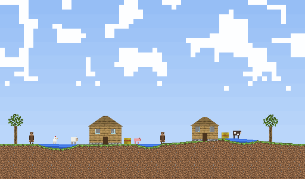
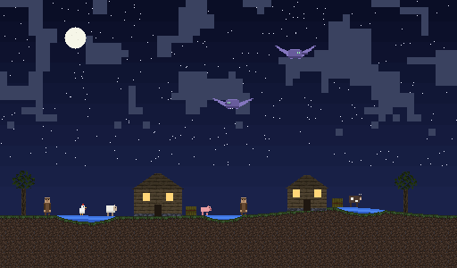
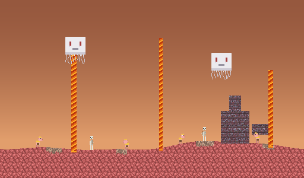
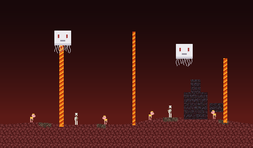
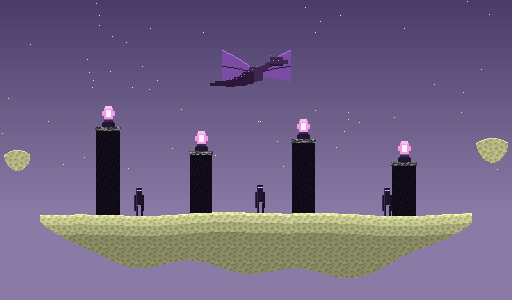
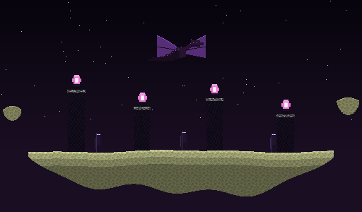

# Minecraft Theme for NarraFork

> **RuoXi-Auto 团队项目**
> 本仓库由 [RuoXi-Auto](https://github.com/RuoXi-Auto) 团队维护。

Minecraft 主题插件 for **NarraFork** —— 三套按维度划分的界面主题，全部取材于原版 Minecraft 方块材质。

包含 **主世界**、**地狱**、**末地** 三个主题，每个都跟随系统的浅色/深色设置自动切换场景。

---

## 关于 NarraFork

**NarraFork 是一个私有 AI 编程工作台。**

它的核心心智模型是「叙述者」—— 一种带工具的 AI 工作会话。叙述者可以读写文件、运行命令、提问澄清，也支持后台持续执行。在 Git 仓库里工作的会话会自动归入该仓库的项目，让产出和决策过程都可追溯。

围绕这个核心，NarraFork 提供：

| 能力 | 说明 |
| --- | --- |
| **工作空间与项目** | 按仓库自动归类会话，改代码时工作目录设在仓库内 |
| **套路与技能** | 把重复的工作流固化成可复用的自动化 |
| **工具权限** | 敏感调用暂停等待审批，也能用权限规则减少重复弹窗 |
| **终端与容器** | 交互式 shell，以及给插件/基准测试用的 Podman 隔离环境 |
| **通知与 IM 网关** | 长任务完成、失败、权限请求可推送到外部 |
| **插件系统** | 用 `.nfplugin` 包扩展界面与能力 —— 本仓库就是一个主题插件 |

推荐流程：先配置供应商与模型 → 给叙述者明确目标（大改动先让其计划）→ 检查工具结果与代码差异再合并。

> 一句话提醒：工具调用成功不等于产出正确，构建、测试和用户可见行为仍需验证。

本主题插件就是在这个平台上替换界面外观的那一层。

---

## 主题预览

三个主题都是 `colorScheme: "both"`，跟随系统浅色/深色自动切换。

### Minecraft — Overworld（主世界）

白天是地表景观，夜晚换成星空下的同一片村庄。

| 白天 | 夜晚 |
| --- | --- |
|  |  |

- **白天**：滚动云层、起伏草地、水坑、两栋村庄房屋、五种生物（村民/鸡/猪/羊/牛）
- **夜晚**：星空与月亮、亮灯的窗户、两只在天空中盘旋的**幻翼**

### Minecraft — Nether（地狱）

同一片下界在两种曝光下的样子。

| 浅色 | 深色 |
| --- | --- |
|  |  |

- 下界岩地表、灵魂沙、三处下落的岩浆柱、猪灵、远处堡垒
- 空中漂浮着**恶魂**，地面上有持弓的**骷髅**

### Minecraft — The End（末地）

末地主岛与虚空。

| 浅色 | 深色 |
| --- | --- |
|  |  |

- 末地主岛、四根黑曜石柱、柱顶的末影水晶、徘徊飞行的**末影龙**
- 岛上徘徊着**末影人**；远处虚空中漂浮着小岛

---

## 特性

- **纯声明式 token** —— 主题只是一个 `manifest.json`，描述颜色、背景、边框和字体。不含 JavaScript，也不注入 CSS 或 DOM。
- **全部使用原版材质** —— 每张方块贴图都是真正的 16×16 原版资源，从 1072×1072 原图逐像素还原后平均降采样，不是手绘仿制。
- **动画背景** —— 512×300、60 帧、无缝循环的 GIF，同样由这些贴图拼出。
- **像素字体** —— Fusion Pixel 10px 子集，配 `fontSize: 20px` 正好是 2 倍整数缩放，避免 12px 栅格在非整数缩放下发虚。
- **不破坏二进制** —— `.gitattributes` 显式声明 `*.gif/png/woff2/nfplugin binary`，防止 `* text=auto` 对素材做换行符转换。

---

## 安装

1. 下载 `dist/minecraft-theme-<version>.nfplugin`
2. 在 NarraFork 中打开 **插件 → 从文件安装**，然后启用
3. 在主题列表里选一个主题，`Ctrl+F5` 硬刷新

> **注意**：每个主题需要**各自选中一次**才会被宿主编译下发 —— 主题列表只返回已启用的主题。切换后如果没生效，先确认该主题已在列表中启用。

---

## 目录结构

```
manifest.json                        三套主题的完整 token 定义
assets/                              方块贴图、背景 GIF、字体
  ├─ tx-sky.gif / tx-sky-night.gif   主世界 白天 / 夜晚
  ├─ tx-nether.gif / -light.gif      地狱 深色 / 浅色
  ├─ tx-end.gif / -light.gif         末地 深色 / 浅色
  └─ font-pixel-10.woff2             像素字体子集
dist/minecraft-theme-<ver>.nfplugin  打包产物
docs/TECHNICAL.md                    技术文档
```

完整的实现细节、素材还原方式、生成器结构与踩坑记录见 **[docs/TECHNICAL.md](docs/TECHNICAL.md)**。

---

## 实现说明

场景是**用代码生成**的而不是手绘的。几个反直觉的点值得提前知道（完整推导与实测数据见 [docs/TECHNICAL.md](docs/TECHNICAL.md)）：

- **云层**：原版 `clouds.png` 的横向连续段长度中位数只有 **2 texel**，孤立单像素占连通块的 42% —— 它本身没有大云板。游戏里看着成块，是因为一个 texel 被渲染成 12×12 格。所以这里必须量化到 64×64 格并做**闭运算**把碎片焊成云板；单纯膨胀会把 24% 覆盖率推到 70%，而闭运算后再腐蚀一圈又会塌到 10%。
- **`opacity` 是遮罩强度，不是图片透明度**：它编译成 `color-mix(in srgb, var(--mantine-color-body) N%, transparent)`，**数值越大图案越淡**。可用区间约 0.05–0.30。
- **`--mantine-color-body` 会给整个界面蒙灰**：所有表面的 scrim 都取它。浅色主题若用很亮的 body，每层遮罩都在叠米白，侧边栏和卡片会一起雾蒙蒙 —— 它必须是能当遮罩用的中深色。
- **浅色方案要重绘，不能叠雾**：在暗场景成品图上盖半透明暖色，观感就是隔毛玻璃。正确做法是地形用**线性增益**抬高（保留甚至放大块间对比），天空单独设计成明亮色。gamma 曲线会把直方图压进窄亮带，那正是「糊」的来源。
- **尺度基准约 10px = 1 格**：据此村民 20px、房屋 40px、末影人 28px。比例错了会立刻被看出来。
- **动画循环**：`FRAMES × STEP` 必须等于纹理周期，否则循环点会突跳。

---
---

## 许可

主题配置与生成的图像：MIT。

Minecraft 是 Mojang 的商标；其中的方块贴图版权归 Mojang，此处仅用于个人主题。NarraFork 为独立项目，本仓库非其官方仓库。
